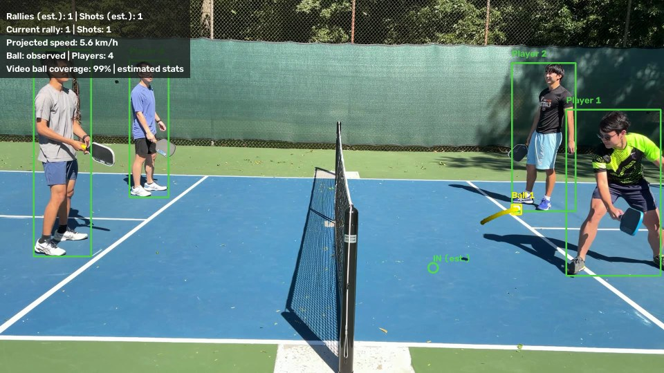

# Vantage

Racket-sport measurements (players, ball, paddles, court position, speed) from a single
phone camera. Capstone project by team Nebula, University of Waterloo.

## Demo

[](docs/sideview-annotated.mp4)

[Watch or download the annotated side-view video](docs/sideview-annotated.mp4) (MP4, about
20 seconds): player and ball tracking with the stats overlay, from the
[desktop pipeline](pipeline/README.md).

## Current status

- **Desktop pipeline:** player and ball tracking, court calibration, estimated shot/rally
  stats, bounce calls, and a landing heatmap from one fixed-camera video.
- **iPhone app:** runs the detector and ball tracker on-device on imported videos, with
  playback overlays. The Swift tracker matches the Python one frame for frame.
- **Detector:** the fine-tuned `pickleball-v1` model tracks the ball in 61.6% of
  visible-ball frames at 96.2% precision on a held-out clip, up from 39.6% with the generic
  model ([details](ml/README.md)).

## What's where

| Folder | What it is | Docs |
| --- | --- | --- |
| `pipeline/` | Desktop Python pipeline (the `vantage` package): detection, tracking, court calibration, stats, heatmaps. The reference implementation. | [pipeline/README.md](pipeline/README.md) |
| `ml/` | Ball labeling, accuracy evaluation, dataset building, detector fine-tuning | [ml/README.md](ml/README.md) |
| `ios/` | iPhone app (SwiftUI) and `VantageKit`, the on-device analysis package | [ios/README.md](ios/README.md) |
| `tools/coreml/` | Core ML export of trained models and PyTorch vs Core ML parity checks | [tools/coreml/README.md](tools/coreml/README.md) |
| `scripts/` | `test.sh` runs every test suite | |
| `assets/`, `docs/` | Sample video and demo media | |

Generated or local-only (git-ignored): `artifacts/` (Core ML exports), `reports/`,
`input/`, `output/`, `.venv/`.

How the parts connect: models trained in `ml/` are exported by `tools/coreml/` into
`artifacts/`, which the iOS app bundles. The Swift ball tracker in `VantageKit` is a port
of the Python tracker in `pipeline/vantage/`, and its tests replay fixtures generated by
the Python tracker, so a tracker change updates both sides in the same PR.

## Setup

**Python.** `pipeline/`, `ml/`, and `tools/coreml/` share one environment.

1. Install [uv](https://docs.astral.sh/uv/): `brew install uv`
2. From the repository root: `uv sync`

This creates `.venv/` with Python 3.13 and the exact versions in `uv.lock`. Run commands
with `uv run`, for example `uv run vantage --input assets/sideview.MOV`. To add a
dependency, use `uv add <package>` (or `uv add --group ml <package>`) and commit the
updated `uv.lock`.

**iOS.** Xcode on a Mac. Follow [ios/README.md](ios/README.md): copy
`ios/Config/Local.xcconfig.example` to `ios/Config/Local.xcconfig` and set your team ID,
export the model, then run `ios/scripts/run_on_iphone.sh`.

## Tests

```sh
scripts/test.sh
```

Runs the pipeline, `ml/`, and `tools/coreml/` Python suites, plus VantageKit's Swift tests
on macOS with Xcode.
