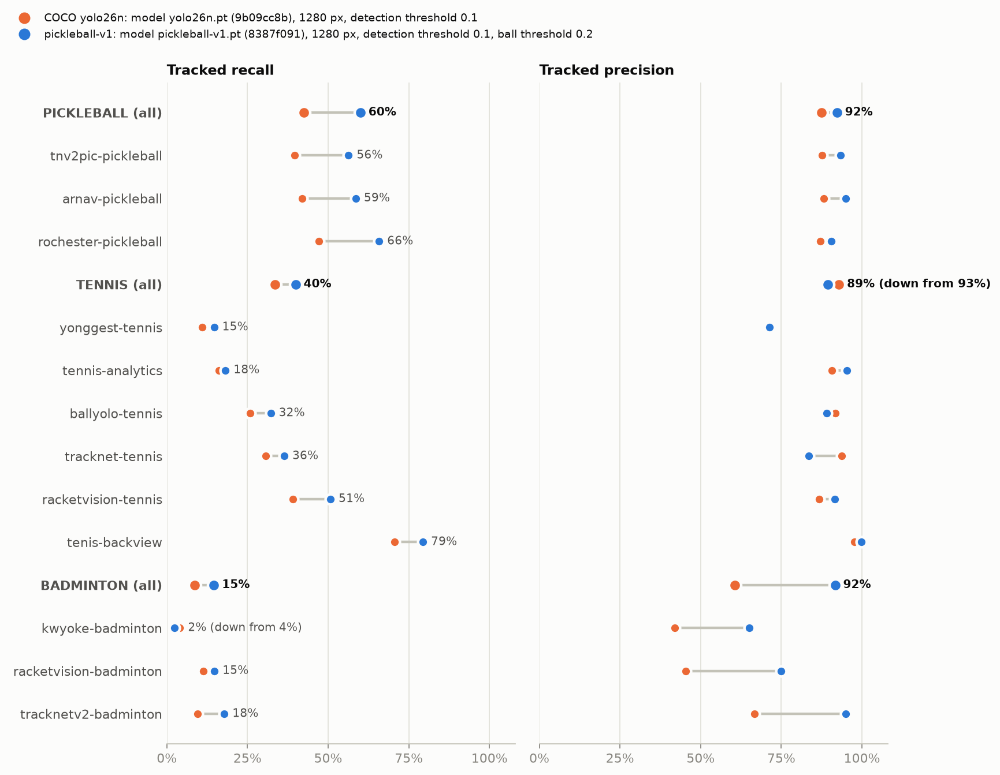
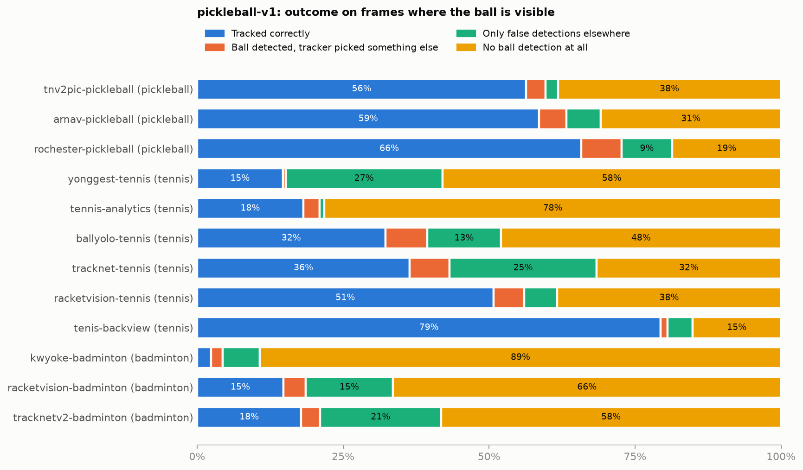

# External eval results, 2026-11-04

The shipped detector (`pickleball-v1`) and the generic COCO model it was fine-tuned from
(`yolo26n`), scored on the public clips in [`ml/EVAL_DATA.md`](../../EVAL_DATA.md): 229 clips,
82,683 labeled frames, 70,844 with a visible ball. Both run in PyTorch at 1280 px, each at the
ball threshold it ships with (`pickleball-v1` 0.20, COCO 0.10). The app runs `pickleball-v1`
through Core ML, which scored about one point lower than PyTorch on our topcorner clip
(`ml/README.md`).

| File | What it is |
| --- | --- |
| `pickleball-v1.json`, `yolo26n.json` | `evaluate_external.py --json` output: every clip, source, and sport |
| `recall_precision.png` | Tracked recall and precision per source, both models |
| `miss_causes.png` | `pickleball-v1`: what happened on every visible-ball frame |

## Results

Tracked recall / precision (the end-to-end number: detector plus `BallTracker`):

| Sport | Visible balls | COCO yolo26n | pickleball-v1 |
| --- | ---: | ---: | ---: |
| Pickleball | 28,234 | 42.6% / 87.5% | **60.0% / 92.2%** |
| Tennis | 17,826 | 33.5% / 92.9% | **39.9% / 89.4%** |
| Badminton | 24,784 | 8.6% / 60.5% | **14.6% / 91.7%** |
| All | 70,844 | 28.4% / 84.9% | **39.1% / 91.4%** |



Sport rows pool frames, so the largest source weighs most (`tnv2pic-pickleball` is 15,879 of
28,234 visible pickleball balls); the chart shows each source.

## What the results say

**Pickleball generalizes beyond our own footage.** 60.0% tracked recall is close to the held-out
topcorner clip under the same PyTorch setup (62.8%; 61.6% on device), and it holds across camera
setups the model never saw: fixed
amateur cameras (`arnav-pickleball` 58.6%), corner cameras (`tnv2pic-pickleball` 56.4%), and a
pro stream (`rochester-pickleball` 65.8%), at 90-95% precision. Fine-tuning added 17 points of
recall over the COCO model.

**The detector limits recall, not the tracker.** Of all visible balls, 44.6% got no ball
detection at all and 12.0% got detections only somewhere else. Only 4.3% were detected on the
ball but not picked by the tracker (pickleball: 30.5%, 4.8%, and 4.7%). Tracker tuning can win
back at most a few points; recall gains have to come from the detector.



**Tennis recall depends on how many pixels the ball covers.** A camera close behind the
baseline tracks 79.4% (`tenis-backview`), while the raised 4K club camera tracks 14.7%
(`yonggest-tennis`): its ball is 7-12 px wide in the 3840 px frame, so 2-4 px at the 1280 px
the model sees. The standing-height amateur camera in `tennis-analytics` (18.2%) loses far,
faint balls the same way, 78.2% with no detection at all.

**False detections show up where the scene has ball-like clutter.** "Only detections
elsewhere" is 25.2% of visible balls in `tracknet-tennis` and 26.9% in `yonggest-tennis`.
In `yonggest-tennis` it is all one clip (`20260328_cb_ag_serve`): the model fires on the
yellow-green player figures printed on a tournament banner, the tracker follows them, and that
clip's tracked recall is 0%. In `tracknet-tennis/game4_clip1` the model detects a spot on a red
billboard in 592 of 598 frames. The tracker's static-clutter filter drops a spot only after
seeing it for a second (`static_min_age_s`), so it follows the billboard at the start of each
clip: 88 frames across the game4 clips, all in their first second. Tennis tracked precision fell
from 92.9% (COCO) to 89.4%, mostly in `tracknet-tennis` (93.7% to 83.6%).

**Badminton needs its own training data.** The model has never seen a shuttlecock: 14.6%
tracked recall, 64.8% of visible shuttles with no detection. Precision rose from 60.5% (COCO) to
91.7%, but on the court-level amateur clips (`kwyoke-badminton`) recall fell from 4.1% to 2.3%.

## What to do with this

- Train for small, far balls: more frames where the ball is a few pixels wide, and a look at
  larger input or crops around the expected ball for 4K video. Score every candidate model on
  this set before it replaces `pickleball-v1` (`ml/README.md`, section 5).
- If tennis or badminton are in scope, they need labeled training data of their own.
- Static clutter gets through in each clip's first second, before the static-clutter filter
  engages. Worth testing a tracker change, scored on this set.
- The desktop pipeline still defaults to the COCO model (`pipeline/vantage/config.py`), so its
  results don't match the app's. To match, replace `CONFIG["model"]` with
  `{"path": "ml/models/pickleball-v1.pt", "classes": {"player": 0, "ball": 1, "paddle": 2}}` and
  set `CONFIG["detection"]["ball_confidence"]` to 0.20, the app's operating point.

## Caveats

- Several sources have no absent labels (`arnav-pickleball`, `yonggest-tennis`,
  `ballyolo-tennis`, `tenis-backview`). There, precision only counts detections in the wrong
  place, not false alarms on empty frames.
- `tnv2pic-pickleball` labels look machine-made; `ml/EVAL_DATA.md` explains how its gaps were
  handled.
- `arnav-pickleball` scores interpolated CVAT frames too; with `--keyframes-only` (320 hand
  keyframes) its tracked recall/precision is 53.4% / 97.2%.

## Reproduce

```sh
uv run python ml/fetch_eval_data.py --all
uv run python ml/evaluate_external.py --weights yolo26n.pt --json > ml/results/external-eval-2026-11-04/yolo26n.json
uv run python ml/evaluate_external.py --json > ml/results/external-eval-2026-11-04/pickleball-v1.json
uv run python ml/plot_external_eval.py \
  "COCO yolo26n=ml/results/external-eval-2026-11-04/yolo26n.json" \
  "pickleball-v1=ml/results/external-eval-2026-11-04/pickleball-v1.json" \
  --output ml/results/external-eval-2026-11-04
```

Detecting all 119,185 frames takes about half an hour per model on an Apple M6 Mac (31-33
minutes measured); later runs re-score from the cache in seconds.
